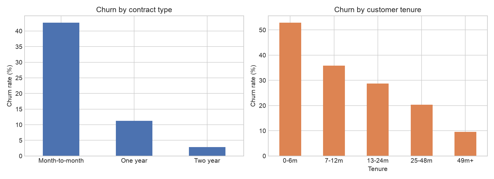
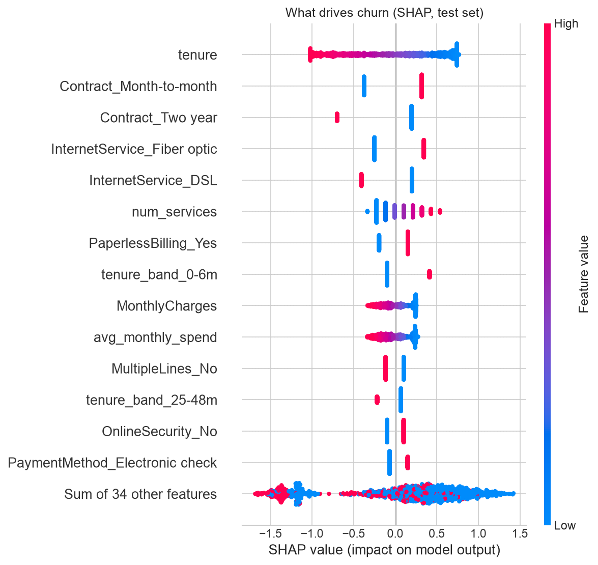
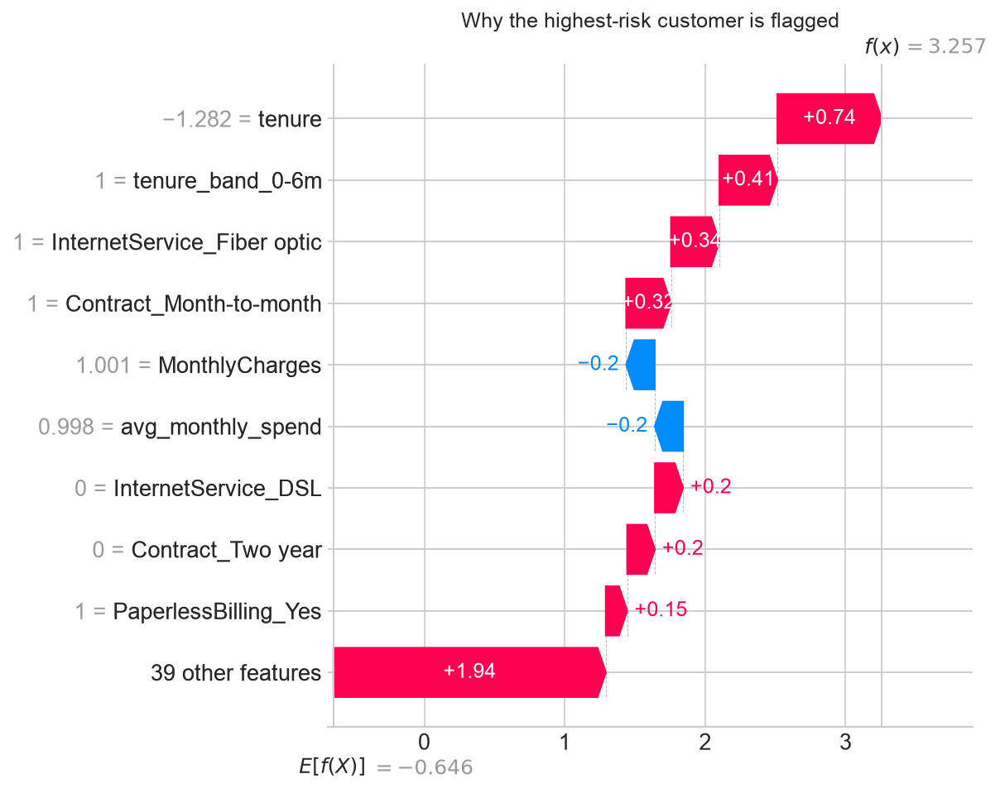
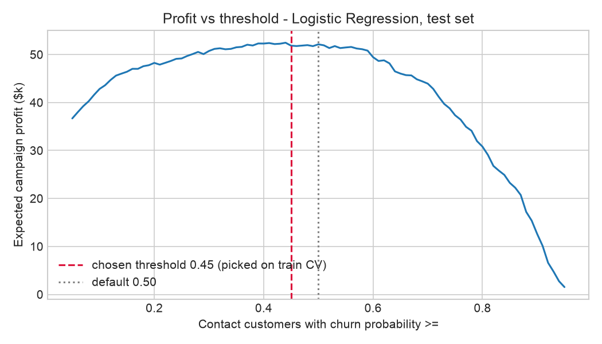
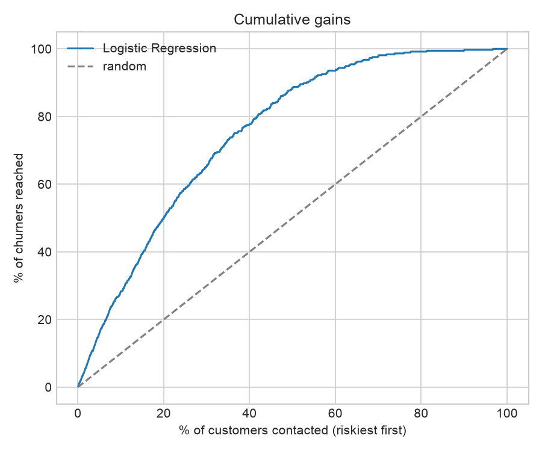
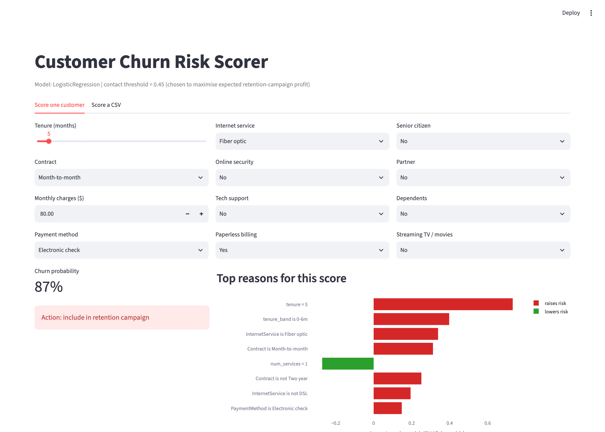

# Customer Churn Prediction with Explainable AI

Predict which telecom customers are about to leave, explain **why**, and decide **who to call** so the retention budget makes the most money.

    

## The business problem

A telecom company loses about 1 in 4 customers. A retention offer (discount or call) costs money, so we cannot send it to everyone.
The question is not just "who will churn?" but **"who is worth contacting?"**

## Key results (held-out test set, 1,409 customers)

| Strategy | Expected campaign profit |
|---|---|
| Contact nobody | $0 |
| Contact everyone | $27,524 |
| Rule of thumb: contact all month-to-month customers | $45,296 |
| **Model-based targeting (this project)** | **$51,853** |

- The model beats the rule of thumb by **$6.5k (+14%)** and "contact everyone" by **+88%** on the same customers.
- Contacting the riskiest **20%** of customers reaches **50%** of all churners (2.5x better than random).
- ROC-AUC **0.845**, recall **83%** of churners at the chosen threshold.

> Profit numbers depend on assumptions in [`src/business.py`](src/business.py): offer cost $50, 30% of contacted churners are saved, a saved customer is worth 12 months of their bill. Change them and re-run to see a new threshold.

## Model comparison

All three models were tuned and compared with 5-fold stratified cross-validation on the training set only. The test set was used once, at the end.

| Model | CV ROC-AUC | Test ROC-AUC | Test PR-AUC | Precision | Recall | Test profit |
|---|---|---|---|---|---|---|
| **Logistic Regression** (selected) | **0.847** | 0.845 | 0.653 | 0.49 | 0.83 | $51,853 |
| Random Forest | 0.845 | 0.841 | 0.652 | 0.45 | 0.87 | $51,925 |
| XGBoost | 0.846 | 0.845 | 0.661 | 0.46 | 0.89 | $53,106 |

**Why Logistic Regression?** It had the best cross-validated profit. XGBoost scored a little higher on the test set, but choosing a model by its test score is a form of leakage, so I kept the rule: *select on CV, report on test*. All three models are within ~1 AUC point, so the simpler, easier-to-explain model is a sensible choice for a business team.

## What drives churn?





- **Short tenure** is the strongest signal: new customers (0-6 months) churn the most.
- **Month-to-month contracts** raise risk; **two-year contracts** cut it sharply.
- **Fiber optic** customers churn more than DSL customers, a sign of a price or service-quality issue worth investigating.
- **Electronic check** payment, **paperless billing** and **no online security / tech support** all add risk.

Each prediction can be explained on its own (below: the highest-risk customer in the test set):



## Choosing the threshold by profit, not by 0.5



The threshold is picked on cross-validated training predictions to maximise expected profit, then checked on the test set.



## Streamlit app



`app.py` gives a business user two tools:

1. **Score one customer** - fill in a form, get the churn probability, a contact / no-contact decision, and the top reasons behind the score.
2. **Score a CSV** - upload a customer file, download a ranked call list.

```bash
streamlit run app.py
```

## Project structure

```
├── app.py                  # Streamlit app (single + batch scoring with explanations)
├── src/
│   ├── features.py         # cleaning + feature engineering
│   ├── business.py         # campaign profit and threshold search
│   └── train.py            # CV, model comparison, test evaluation, SHAP, figures
├── tests/test_features.py  # unit tests for features and profit logic
├── data/raw/               # IBM Telco Customer Churn dataset
├── models/                 # saved pipeline + threshold
└── reports/                # metrics.json and figures
```

## How to run

```bash
python -m venv .venv && source .venv/bin/activate
pip install -r requirements.txt
python -m src.train        # trains models, writes reports/ and models/
pytest -q                  # 4 tests
streamlit run app.py
```

## Feature engineering

- `num_services` - how many add-on services the customer uses
- `avg_monthly_spend` - total charges / tenure
- `charge_increase` - current bill minus historical average (price-rise signal)
- `tenure_band` - lifecycle stage (0-6m, 7-12m, ...)
- Fixed 11 blank `TotalCharges` values (brand-new customers not yet billed) to 0

## Limitations and next steps

- The dataset is a single snapshot; a real system would use monthly snapshots and predict churn in the next 30-90 days.
- Campaign profit uses assumed values; with real offer results, `save_rate` could be learned per segment (uplift modelling).
- Probability calibration and monitoring for data drift would be needed before production use.

## Data

[IBM Telco Customer Churn](https://github.com/IBM/telco-customer-churn-on-icp4d) - 7,043 customers, 21 columns, 26.5% churn rate.
